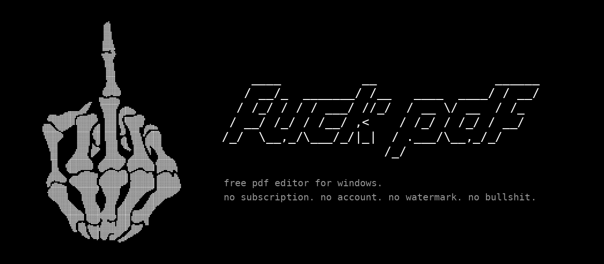
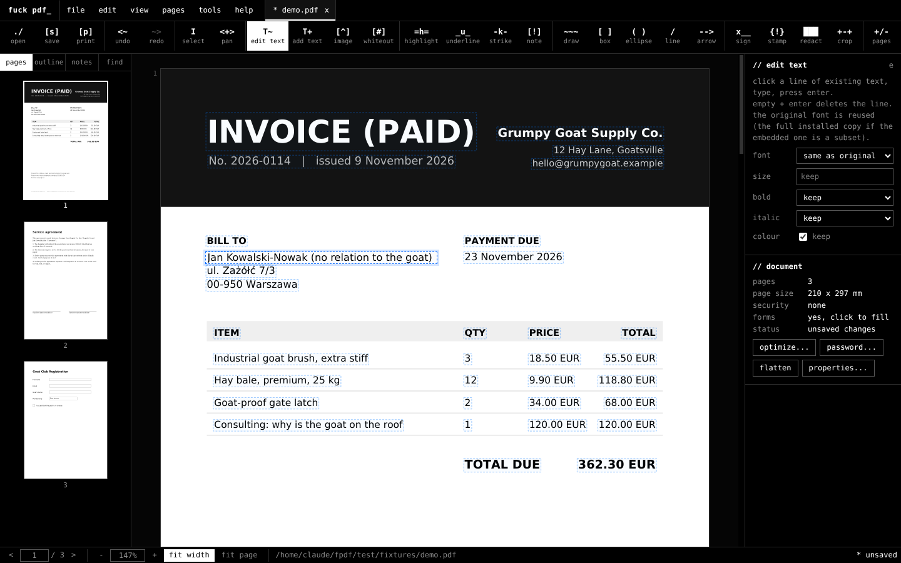
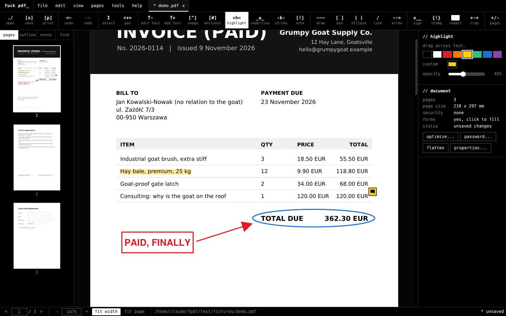
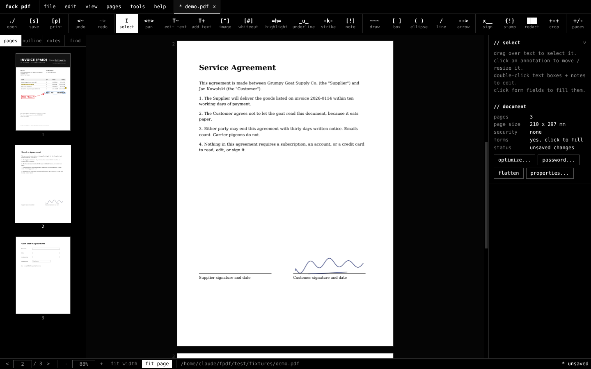
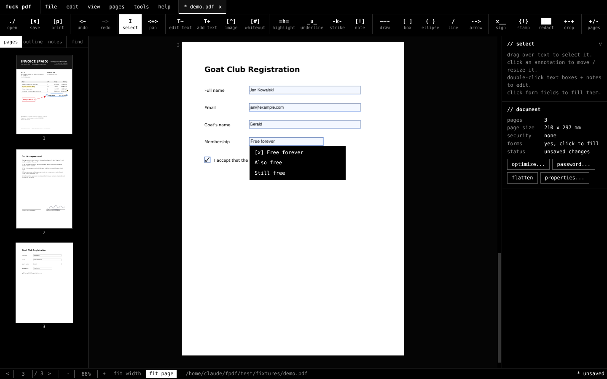
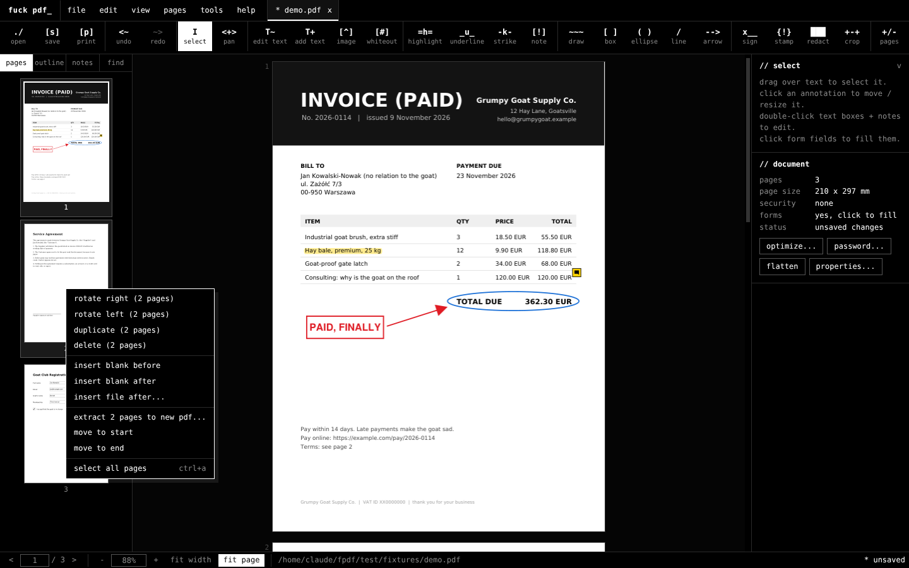
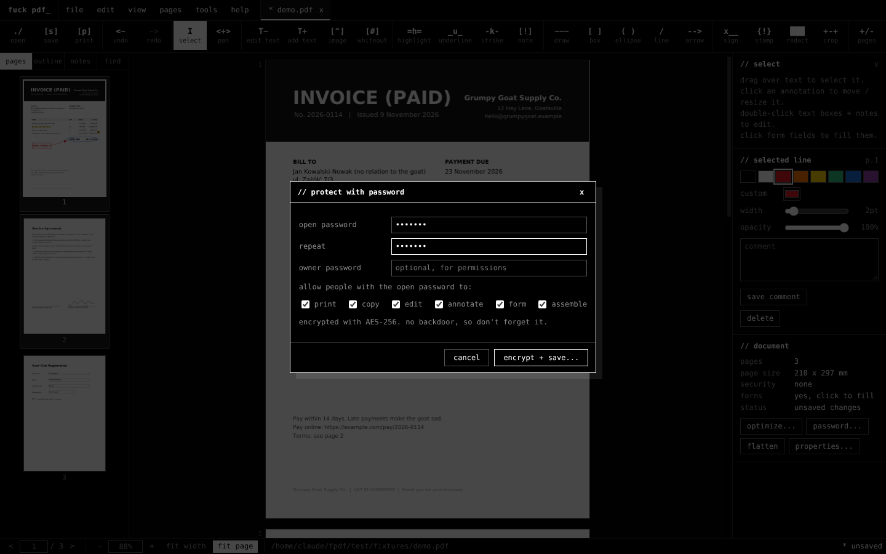
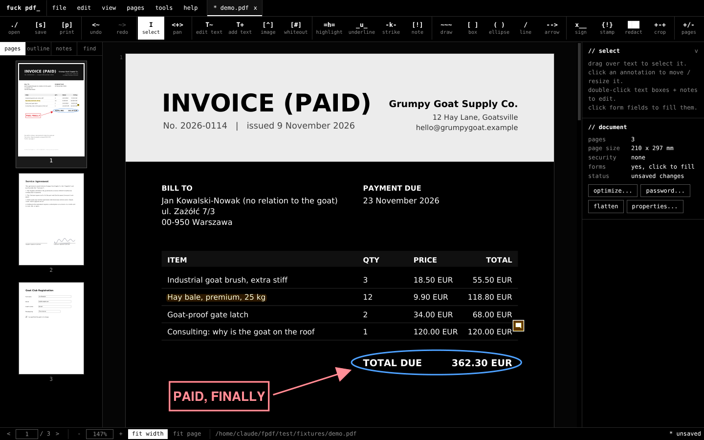

<p align="center">
  
</p>

<h3 align="center">a free pdf editor for windows. it edits pdfs. that's it. that's the whole business model.</h3>

<p align="center">
  <a href="#download">download</a> &nbsp;|&nbsp;
  <a href="#what-it-does">features</a> &nbsp;|&nbsp;
  <a href="#screenshots">screenshots</a> &nbsp;|&nbsp;
  <a href="#updates">updates</a> &nbsp;|&nbsp;
  <a href="#build-it-yourself">build</a>
</p>

---

## why

You have a PDF. It has one typo in it. One.

So you go looking for a "free PDF editor". You download it. You fix the typo. You press save. And *that* is the moment it tells you saving is a premium feature. Or it saves, and stamps a fat watermark across every page. Or it wants an account first. Or an email address "to send you your file". Or it's a website that uploads your contract, your bank statement and your medical letter to a server you have never heard of, in a country you couldn't point to.

PDF is an open standard. It has been for years. The buttons to edit it are still behind a monthly subscription.

**fuck that.**

So here's the thing they charge for, minus the charge. Every feature, on, for everyone, forever. No trial. No watermark. No export limit. No account. No telemetry. No cloud. No "upgrade" button, because there's nothing to upgrade to. This is it. All of it.

## screenshots

**edit the text that's already there.** click a line, type, enter. it keeps the original font, size and colour, and the old text is actually gone, not hidden under a white box.



**mark it up.** highlights, circles, arrows, sticky notes, stamps that say whatever you want.



**sign it.** draw it, type it, or use an image. saved on your machine for next time.



**fill the form.** text fields, checkboxes, dropdowns. tab between fields like a normal person.



**shuffle pages around.** drag thumbnails to reorder. right-click to rotate, duplicate, delete, extract, insert.



**lock it.** AES-256 passwords and permissions. no backdoor, so write the password down.



**night mode** for 2am contract reading, because of course it's 2am.



## what it does

Everything runs on your computer. Nothing is uploaded. The only network request it ever makes is a once-a-day update check, and you can switch that off.

| the thing | what it usually costs | what it costs here |
|---|---|---|
| edit existing text, in the original font | a subscription | nothing |
| add text, images, whiteout | a subscription | nothing |
| sign: draw, type, or image | a subscription, sometimes per document | nothing |
| fill forms, reset them, flatten them | depends on the mood of the vendor | nothing |
| **real** redaction (deletes the content, not a black box over it), plus search-and-redact | a subscription | nothing |
| merge files, images to pdf | a subscription | nothing |
| split, extract, insert, delete, duplicate, reorder, rotate, crop, resize pages | a subscription | nothing |
| watermarks, headers, footers, page numbers, Bates numbering | a subscription | nothing |
| password protection, permissions, removing passwords | a subscription | nothing |
| compress, strip metadata and hidden scripts | a subscription | nothing |
| highlight, underline, strike out, notes, freehand, boxes, ellipses, lines, arrows, stamps | sometimes free, if you sit through the upsell | nothing |
| export pages to png / jpg, all text to txt, print | sometimes free | nothing |
| clickable links (web links open in your browser, internal links jump to the page) | free, fair enough | nothing |
| undo / redo for every single edit | | nothing |
| a white on black interface with a skeleton giving you the finger | not available at any price | nothing |

It also opens images, EPUB, CBZ, HTML and plain text files and turns them into PDFs, so every tool works on those too.

### about that "edit text" thing

The usual "free" trick: paint a white rectangle over the old words and type new ones on top. The old text is still in the file. Copy it, search it, it's all still there, sitting under a white box like a body under a rug.

Not here. Click a line, change it, press enter:

- the old glyphs are **removed from the page**, for real
- the new text goes in the **same spot**, **same size**, **same colour**
- in the **same font**. PDFs usually embed only the letters they used, so if your edit needs a letter that isn't there, fuck pdf finds the full font installed on your computer and uses that. A generic font is the last resort, not the first one.
- light text on a dark background stays readable while you edit it
- Polish, Czech, German, whatever. `Zażółć gęślą jaźń` works. It's in the test suite.

## download

Pick one:

- **`fuck-pdf-x.y.z-setup.exe`**: installs it, adds start menu entries (the app and its updater), and shows up under "Open with" for PDF files.
- **`fuck-pdf-x.y.z-portable.exe`**: one file. No install. Run it from your desktop, a USB stick, a network drive, wherever. It can still update itself.
- **`fuck-pdf-updater.exe`**: 6 MB. Run it on a machine without fuck pdf and it installs the latest version for you.

`SHA256SUMS` lists the checksum of every file, if you want to check them yourself.

The exe isn't signed, because signing certificates cost money every year and see "why". Windows will show **"Windows protected your PC"**. Click **More info**, then **Run anyway**. And if you'd rather not trust a random exe from the internet: good instinct. The source is right here. Read it, then build it yourself.

## updates

fuck pdf updates itself, without a background service, a tray icon, or anything nagging you.

- **once a day at startup** it asks the updater whether there's something new. if there is, you get a small note with an "update" button. turn it off under **help > check for updates on startup**.
- **help > check for updates** does it right now.
- **the updater** is a separate little program (start menu: "fuck pdf updater"). it finds the newest version, downloads it, checks its SHA-256 against `SHA256SUMS`, closes fuck pdf (it asks you to save first), installs silently and starts it again. if the checksum doesn't match, it refuses to install, full stop.
- **portable copies** replace themselves in place.
- **installed for all users** (Program Files)? it updates that copy, so windows asks for admin rights once per update.

```
    ____           __                ______
   / __/_  _______/ /__   ____  ____/ / __/
  / /_/ / / / ___/ //_/  / __ \/ __  / /_
 / __/ /_/ / /__/ ,<    / /_/ / /_/ / __/
/_/  \__,_/\___/_/|_|  / .___/\__,_/_/
                      /_/   updater

  installed:  1.1.0   (C:\Users\you\AppData\Local\Programs\fuck pdf)
  looking for updates...
  latest:     1.1.1   (github skinwaffle-repo/fpdf)
  downloading fuck-pdf-1.1.1-setup.exe
  [################################] 100%   126.3 / 126.3 MB
  sha-256 ok
  installing (silent)...
  done. fuck pdf 1.1.1 is installed.
```

### where it looks

In order, newest version wins:

1. **GitHub Releases** of this repo
2. **a folder**, by default `%USERPROFILE%\Nextcloud\FPDF`. drop a new `fuck-pdf-x.y.z-setup.exe` (and its `SHA256SUMS`) into a synced or shared folder and every machine picks it up. no internet needed.

Change that in `%APPDATA%\fuck pdf\updater.json` (survives updates) or in `updater.json` next to the updater:

```json
{
  "sources": [
    { "type": "github", "repo": "skinwaffle-repo/fpdf", "token": "" },
    { "type": "folder", "path": "\\\\fileserver\\software\\fuck pdf" }
  ]
}
```

`token` is only needed if the repo is private. Command line, for scripts and IT people:

```
fuck-pdf-updater.exe                       check, ask, update
fuck-pdf-updater.exe --check --json        just report: {"current":"1.1.0","latest":"1.1.1","available":true,...}
fuck-pdf-updater.exe --yes --no-relaunch   unattended update (e.g. on a schedule)
--source github:owner/repo                 override the sources (repeatable)
--source folder:C:\path
```

## keyboard

| key | does |
|---|---|
| `v` / `h` | select / pan (or hold `space`, or drag with the middle mouse button) |
| `e` / `t` | edit existing text / add new text |
| `l` / `u` / `k` | highlight / underline / strike out |
| `d` / `r` / `o` / `a` | draw / box / ellipse / arrow |
| `n` / `i` / `s` / `m` | note / image / sign / stamp |
| `w` / `x` / `c` | whiteout / redact / crop |
| `ctrl+z` / `ctrl+y` | undo / redo |
| `ctrl+f` / `ctrl+g` | find / go to page |
| `ctrl+wheel` | zoom at the cursor |
| `ctrl+1` / `ctrl+2` | fit width / fit page |
| `ctrl+shift+n` | night mode |
| `f1` | all of them |

## build it yourself

You need Node.js 20 or newer, and Go 1.22 or newer for the updater.

```sh
npm install
npm start              # run it
npm test               # engine tests: text editing, redaction, forms, links, encryption, page surgery
npm run test:ui        # drives the real app and clicks through it
npm run test:updater   # updater tests
npm run dist:win       # updater + portable exe + installer + SHA256SUMS, into dist/
```

The portable exe builds on any OS. Building the installer on Linux needs Wine.

```
src/
  engine.mjs         every pdf operation, unit tested
  fontindex.mjs      reads your installed fonts so edited text matches the original
  engine-worker.mjs  runs the engine off the UI thread, so nothing ever freezes
  main.js            window, files, dialogs, printing
  preload.js         the narrow bridge between the two halves
  renderer/          the interface: viewer, tools, dialogs, menus
updater/             the updater (Go): sources, checksums, silent install, portable swap
test/                engine tests, scripted UI runs, windows build check
docs/                logo and screenshots
```

## what it doesn't do (yet)

Honesty is also free.

- **OCR** for scanned documents
- **certificate-based digital signatures** (the cryptographic kind). "sign" places a visible signature, which is what most people mean by signing.
- **reflowing whole paragraphs** when editing. editing works line by line.
- XFA forms (the cursed kind), PDF/A conversion, comparing two documents

Pull requests welcome. Angry ones especially.

## credits

fuck pdf stands on the shoulders of people who give their work away for free. Respect.

**inside the app** (ships in the exe)

| what | does | license |
|---|---|---|
| [MuPDF](https://mupdf.com) by Artifex Software | the actual PDF engine: rendering, text, annotations, redaction, forms, encryption, page surgery. the heavy lifting is all theirs. | AGPL-3.0-or-later |
| [Electron](https://www.electronjs.org), with Chromium and Node.js inside | the window and the runtime | MIT (Chromium's own licenses ship in the app folder as `LICENSES.chromium.html`) |
| [Go](https://go.dev) runtime and standard library | the updater | BSD-3-Clause |

**used to build, test and draw it** (not shipped)

| what | used for | license |
|---|---|---|
| [electron-builder](https://www.electron.build) | packaging the portable exe and the installer | MIT |
| [NSIS](https://nsis.sourceforge.io) | the installer itself | zlib/libpng |
| [resedit](https://github.com/jet2jet/resedit-js) | stamping the icon and version info into the exe | MIT |
| [Wine](https://www.winehq.org) | building the installer on Linux, testing the Windows build | LGPL-2.1-or-later |
| [Playwright](https://playwright.dev) | driving the real app for UI tests and screenshots | Apache-2.0 |
| [ReportLab](https://www.reportlab.com/opensource/) | generating the test and demo PDFs | BSD |
| [Pillow](https://python-pillow.org) | rendering the icon and the logo | MIT-CMU |
| [pyfiglet](https://github.com/pwaller/pyfiglet) and the FIGlet "slant" font by Glenn Chappell | the FUCK PDF banner | MIT / FIGlet font license |
| [DejaVu fonts](https://dejavu-fonts.github.io) | the logo, the screenshots, the test documents | Bitstream Vera / DejaVu license |

**the finger:** skeleton middle finger dot art, found on a dot-art site, artist unknown. If it's yours, open an issue and your name goes right here.

## license

**AGPL-3.0-or-later.** See [LICENSE](LICENSE).

Free forever, and anyone who ships a modified version has to publish their source too. Nobody gets to take this, bolt a paywall on it, and sell it back to you. That's not an accident. That's the point. (It's also the license of MuPDF, the engine inside, so it would be AGPL either way. Happy coincidence.)

---

<p align="center"><code>no subscription. no account. no telemetry. no watermark. no bullshit.</code></p>
